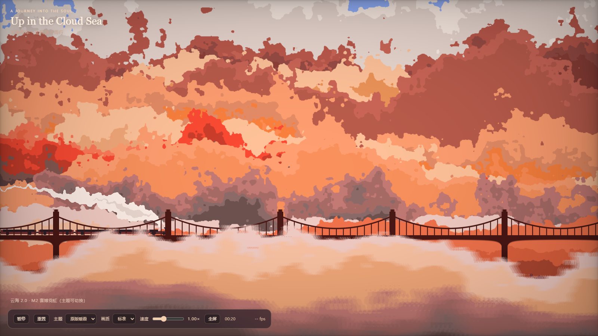
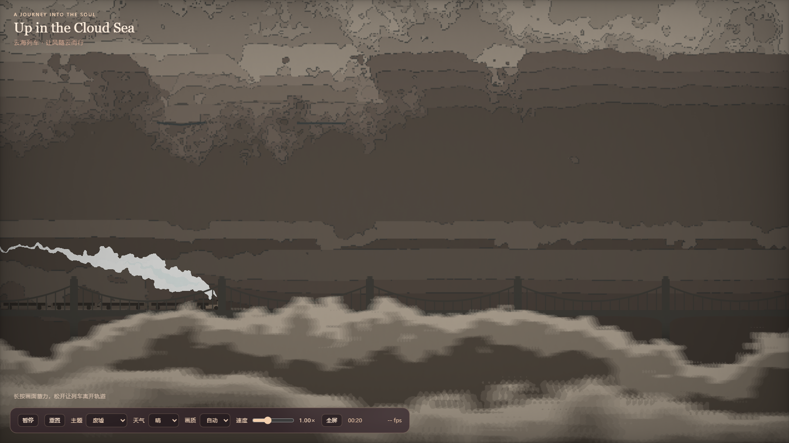
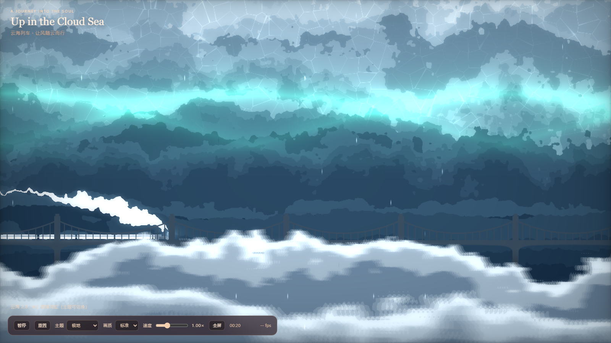
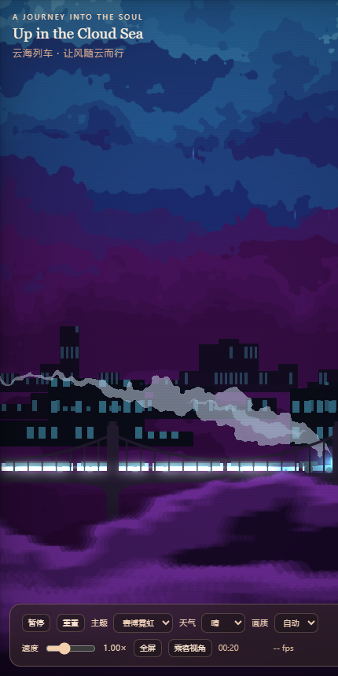
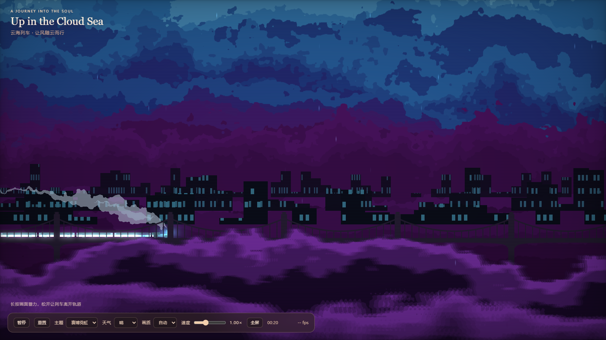
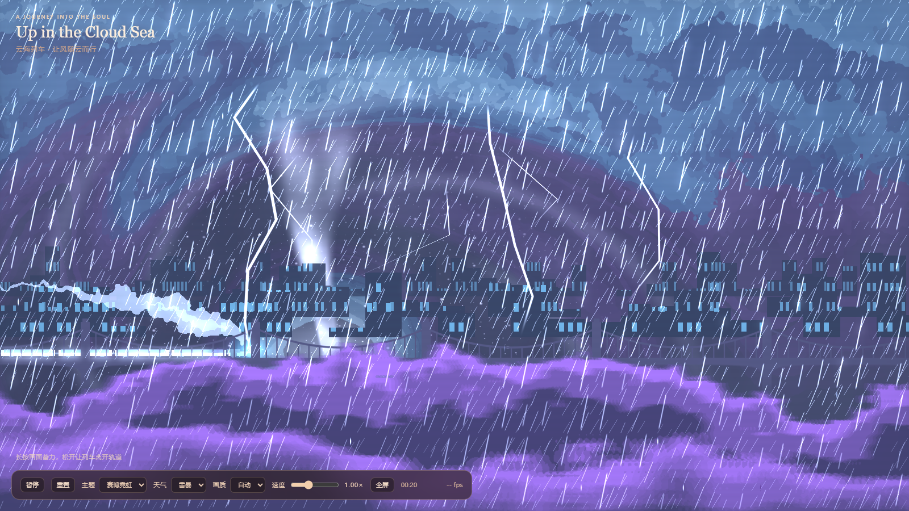
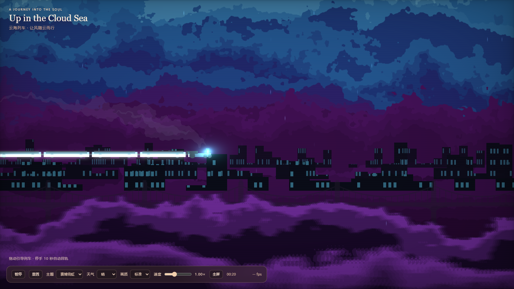
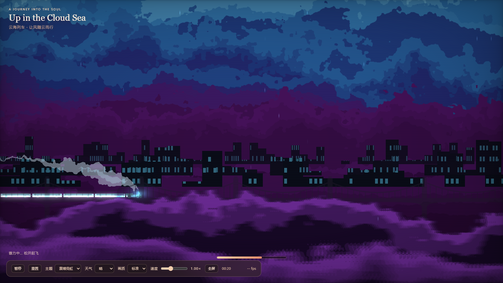

# 云海 2.0（cloudsea-v2）

从《云海拾句》原版剥离出来的**单场景云海**工程：去掉全部诗句与工作台，去掉星云/极光场景，只保留云海 + 列车 + 桥 + 暗角，并把色彩系统改造成可热切换的主题。

当前进度：**M0 清理 → M1 主题 → M2 赛博霓虹 → M2b 多 pass + bloom → M3 水墨 → M4 极地 → M5 液态云 → M6 天气 → M7 列车操控 → M8 乘客视角（后移除）→ M9 打磨发布 → M10 天气重制 → M11 暴雨/暴雪/龙卷/闪电 → M12–M19 雨丝质感与龙卷细化 → M20 雨/闪电/龙卷融入云的画法 → M21 穿云演出 → M22 移除大雨/大雪 → M23–M24 神龙与巨鲸（M25 已删除）→ M26 程序化音频（P0）**。
交接给 AI/其他开发者看 [`AGENTS.md`](AGENTS.md)（入口）、[`CLAUDE.md`](CLAUDE.md)（完整手册）与 [`docs/交接.md`](docs/交接.md)；开发计划见 [`docs/开发计划.md`](docs/开发计划.md)，基线数据见 [`docs/bench/m0.md`](docs/bench/m0.md) 起的 m0–m9 系列；方向变更见 [开发日志](docs/开发日志.md)。

| 原版暖霞 classic | 赛博霓虹 cyber | 废墟 ruins | 极地 polar |
| --- | --- | --- | --- |
|  |  |  |  |

移动端（430×860）：



两种天气（赛博霓虹）：

| 晴 | 雷暴（闪电瞬间） |
| --- | --- |
|  |  |

列车飞行与蓄力：

| 飞行中（脱轨、桥淡出、拨云跟随） | 蓄力条 |
| --- | --- |
|  |  |

- **cyber**：渐变夜空 + 星点、三层视差城市剪影（窗光可调）、银灰车身 + 青色霓虹灯带 + 车头光晕、上升粒子、扫描线；
- **ruins（原水墨）**：灰褐废墟调、`dFdx/dFdy` 积墨边缘 + 飞白、宣纸纤维、远山、振翅仙鹤、木纹车厢；
- **polar**：冷白调色、三条极光带（云上）、Voronoi 冰晶棱线、车顶积雪、雪粒；
- **天气**：晴 / 雷暴（暴雨 + 龙卷漏斗 + 锯齿闪电 + 飓风级云速）。
- 指针横移会带来星点/城市/粒子/远山的轻微视差（云层速度不变）。

## 运行

**方式一：直接玩发布包**（单文件，双击即开，无需服务）

```text
dist/cloudsea.html
```

**方式二：开发模式**（改代码用；用 `fetch` 加载 `.glsl`，需要 HTTP）

```powershell
cd cloudsea-v2
python -m http.server 8789 --bind 127.0.0.1
# 打开 http://127.0.0.1:8789/index.html
```

改完代码重新打包：

```powershell
node tools/build-singlefile.mjs      # → dist/cloudsea.html
```

操作：**长按画面**蓄力，松开让列车脱轨起飞；飞行中移动指针引导，停手 10 秒自动回轨。
快捷键：`Space` 暂停 / `R` 重置 / `F` 全屏 / `C` 穿云；主题与天气（晴 / 雷暴）用右下角下拉切换。

**穿云**（HUD 按钮或 `C`）：厚云从脚下涨满画面 → 镜头切到第一人称冲出云层、云被冲击波炸散 → 平滑拉回远景，约 6 秒。


## 常用 URL 参数

| 参数 | 用途 |
| --- | --- |
| `?theme=classic\|cyber\|ink\|polar` | 指定主题 |
| `?freeze=1&t=12.5` | 冻结时间，确定性渲染（截图对比用） |
| `?bench=60&w=1920&h=1080` | 同步渲染 60 帧并量平均帧时，结果写进 `#bench` 与标题 |
| `?report=1` | 把 bench 结果 POST 给 `tools/bench-server.py` |
| `?quality=0.5\|1\|2` | 画质档位（同时决定云层渲染倍率 0.5 / 0.75 / 1.0） |
| `?cloudscale=0.5\|0.75\|1` | 直接指定云层渲染倍率（覆盖 quality 映射） |
| `?carve=N` | 把"列车拨云"强度放大 N 倍（调试用） |
| `?weather=sunny\|storm` | 指定天气（直接以该状态启动，不做 8 秒过渡） |
| `?flash=0.8` | 强制闪电亮度（截雷暴用） |
| `?train=x,y` | 直接把列车停在飞行姿态（调试/截图） |
| `?charge=0.65` | 直接停在蓄力状态（截蓄力条） |
| `?burst=2.8` | 穿云演出定格在第 N 秒（配合 `freeze=1` 截图） |
| `?quality=auto\|0.5\|1\|2` | 画质（默认 auto：按帧时自动调云倍率） |

## 目录

```text
index.html                  # canvas + HUD（主题 / 画质 / 速度 / 暂停）
src/main.js                 # 时间轴、渲染循环、HUD、bench、指针视差
src/engine/gl.js            # 编译 program、全屏三角形、噪声纹理
src/engine/fbo.js           # 离屏渲染目标
src/engine/clock.js         # 暂停 / 倍速 / 冻结时间
src/scene/cloudsea.js       # 7 个 pass 的编排 + setTheme（不重编译）
src/themes/theme.js         # 主题数据：云层 / 天空 / 列车 / 城市 / 粒子 / bloom
src/shaders/                # sky / fg / composite / bright / blur / final + common
assets/noise.png            # 1024² 噪声（fbm 的原料）
tools/bench-server.py       # bench 结果收集器
shots/                      # 截图与基线对照
docs/                       # 开发计划、bench 记录
```

## 主题系统怎么工作

- 云的层数、几何（midlevel/disp/dist/phase/色带高度）与配色**全部是数据**，打包成 `uLayer[16]`、`uBandDh[16]`、`uBandCount[16]` 和一张 128×1 的 `RGBA32F` 调色板纹理；
- 天空（渐变 + 星点）、列车材质（车身/车顶/饰条/霓虹/烟/桥）、城市（开关/颜色/窗光）、粒子（颜色/密度/速度）、扫描线也都是主题字段；
- shader 用循环 + `texelFetch` 取色，**加一套皮肤不需要改 shader**；
- `renderer.setTheme()` 只做 uniform 上传 + 一次纹理上传，同帧生效，无重编译、无白屏；
- `classic` 的数值逐条复刻原版，并关闭所有新元素，作为「重构不改变画面」的回归基线。

## 相对原版改了什么

- 删：诗句数据/渲染/命中层、工作台、成诗浮层、情绪分析、星云与极光场景、内联字体、BGM、死代码；
- 留：云海 14 层云、列车/烟/桥/前景云、暗角后期、两趟渲染、时间轴语义；
- 加：模块化结构、数据化云层 + 主题热切换、夜空/星点/城市/粒子/霓虹等主题元素、指针视差、`?freeze/?bench` 确定性渲染与帧时测量。

验证结果：

- 去掉诗句后与原版逐像素误差 0.056/255（M0）；
- 主题重构后 classic 与原版只剩 1px 抗锯齿边缘差异，3×3 实心差异块 **0 个像素**（M1）；
- 叠加 M2 的夜空/城市/粒子/霓虹后，classic 与 M1 相比 **最大差 1/255**，说明新元素完全被主题参数门控（M2）；
- 多 pass 重构后，classic 在全分辨率下仍与原版等价（0 个实心差异块），默认 0.75 云倍率是画质取舍（M2b）；
- 1080p 帧时（Intel Arc 核显）：cyber 约 **8.9 ms**（含 bloom）、classic 约 6.4 ms；接受云层柔化可降到 4.2–4.9 ms。

## 下一步

见 [`CLAUDE.md`](CLAUDE.md) §8 与 [`docs/交接.md`](docs/交接.md) §5：音频 → 竖屏构图 → 飞行姿态 → 雷暴云增厚 → 雷暴雨簇与水花 → 废墟墨线 / 极光混色。
